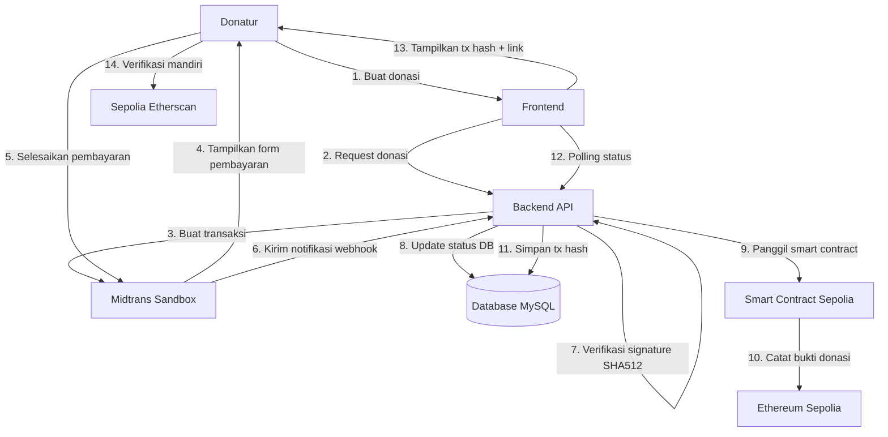
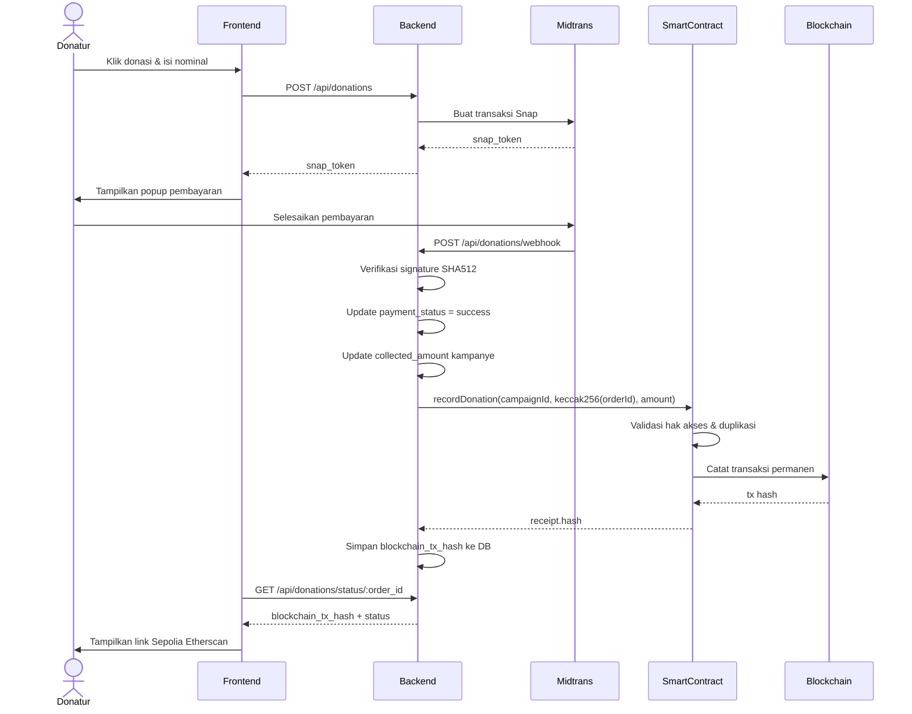
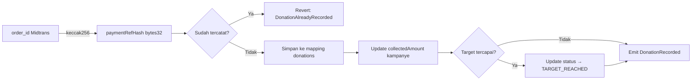
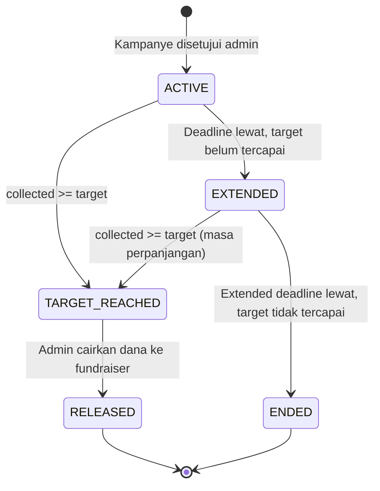
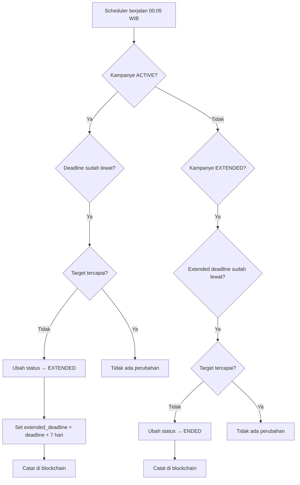

# Dokumentasi Blockchain DonasiChain
## Laporan Project Akhir — Mata Kuliah Blockchain

**Nama:** Devi
**Bagian:** Blockchain Development & Smart Contract
**Platform:** DonasiChain — Crowdfunding Berbasis Blockchain

---

## 1. Tujuan Penggunaan Blockchain pada DonasiChain

DonasiChain menggunakan teknologi blockchain sebagai media **pencatatan dan transparansi transaksi donasi**, bukan sebagai payment gateway.

Tujuan utama:
- Setiap donasi yang berhasil diverifikasi dicatat secara permanen di blockchain
- Catatan tidak dapat diubah atau dihapus oleh siapapun
- Donatur dapat memverifikasi sendiri transaksi mereka melalui Sepolia Etherscan
- Meningkatkan kepercayaan publik terhadap platform crowdfunding

Hal yang **tidak** dilakukan blockchain di DonasiChain:
- Tidak menyimpan atau mengelola dana (uang Rupiah)
- Tidak memproses pembayaran
- Tidak menyimpan data pribadi donatur

---

## 2. Alasan Memilih Ethereum Sepolia

| Alasan | Penjelasan |
|---|---|
| Testnet resmi Ethereum | Sepolia adalah testnet resmi yang direkomendasikan untuk pengembangan |
| Tidak menggunakan uang sungguhan | Menggunakan Sepolia ETH gratis dari faucet |
| Kompatibel dengan tools standar | Didukung Hardhat, ethers.js, MetaMask, dan Etherscan |
| Infrastruktur stabil | Lebih stabil dibanding testnet lain seperti Goerli yang sudah deprecated |
| Mudah diverifikasi | Transaksi dapat dilihat publik di sepolia.etherscan.io |

---

## 3. Arsitektur Integrasi Blockchain



---

## 4. Diagram Alur Transaksi



---

## 5. Struktur Smart Contract

```
DonasiChain.sol
│
├── Structs
│   ├── Campaign       — data kampanye
│   └── Donation       — data donasi
│
├── State Variables
│   ├── owner                  — alamat pemilik contract
│   ├── authorizedBackends     — mapping wallet yang diotorisasi
│   ├── campaigns              — mapping campaignId → Campaign
│   ├── donations              — mapping donationId → Donation
│   └── campaignIds            — array semua campaign ID
│
├── Events
│   ├── CampaignCreated
│   ├── DonationRecorded
│   ├── CampaignExtended
│   ├── CampaignStatusUpdated
│   ├── BackendAuthorized
│   └── BackendRevoked
│
├── Modifiers
│   ├── onlyOwner
│   └── onlyAuthorized
│
├── Write Functions
│   ├── createCampaign()
│   ├── recordDonation()
│   ├── updateCampaignStatus()
│   ├── extendCampaign()
│   ├── authorizeBackend()
│   └── revokeBackend()
│
└── Read Functions
    ├── getCampaign()
    ├── getDonation()
    ├── isDonationRecorded()
    └── getAllCampaignIds()
```

---

## 6. Penjelasan Setiap Fungsi

### createCampaign(campaignId, title, targetAmount, deadline)
Mencatat kampanye baru ke blockchain saat admin menyetujui kampanye di platform. Menyimpan ID, judul, target dana, dan tenggat waktu. Hanya dapat dipanggil wallet yang diotorisasi.

### recordDonation(campaignId, paymentRefHash, amount)
Fungsi utama pencatatan donasi. Dipanggil backend setelah pembayaran Midtrans dinyatakan sukses dan terverifikasi. Menggunakan `keccak256(order_id)` sebagai referensi pembayaran sehingga tidak ada data pribadi donatur yang tersimpan di blockchain. Mencegah pencatatan ganda dengan memeriksa keunikan `paymentRefHash`.

### updateCampaignStatus(campaignId, newStatus)
Memperbarui status kampanye di blockchain. Dipanggil scheduler backend secara otomatis setiap hari saat deadline kampanye terlewat. Status valid: `ACTIVE`, `EXTENDED`, `TARGET_REACHED`, `RELEASED`, `ENDED`.

### extendCampaign(campaignId, newDeadline)
Memperpanjang tenggat kampanye dan mengubah status menjadi `EXTENDED`. Dipanggil saat kampanye belum mencapai target pada tenggat awal.

### getCampaign(campaignId)
Fungsi baca untuk mengambil seluruh data kampanye. Tidak memerlukan gas karena hanya membaca data.

### getDonation(donationId)
Fungsi baca untuk mengambil data donasi berdasarkan `paymentRefHash`. Dapat digunakan untuk verifikasi independen.

### isDonationRecorded(paymentRefHash)
Mengecek apakah sebuah donasi sudah tercatat. Berguna untuk idempotency check sebelum mencatat ulang.

### authorizeBackend(backend) / revokeBackend(backend)
Mengelola daftar wallet yang diizinkan memanggil fungsi write. Hanya pemilik contract yang dapat menambah atau mencabut otorisasi.

---

## 7. Penjelasan Event

### CampaignCreated
Dipancarkan saat kampanye baru berhasil dicatat. Berisi `campaignId`, `title`, `targetAmount`, `deadline`, dan `timestamp`. Digunakan backend untuk mengkonfirmasi kampanye sudah tercatat di blockchain.

### DonationRecorded
Dipancarkan setiap donasi berhasil dicatat. Berisi `campaignId`, `donationId`, `paymentRefHash`, `amount`, dan `timestamp`. Event ini adalah bukti utama transparansi donasi yang dapat ditelusuri siapapun di Etherscan.

### CampaignExtended
Dipancarkan saat tenggat kampanye diperpanjang. Berisi `campaignId`, `newDeadline`, dan `timestamp`.

### CampaignStatusUpdated
Dipancarkan setiap kali status kampanye berubah. Berisi `campaignId`, `oldStatus`, `newStatus`, dan `timestamp`. Memungkinkan penelusuran riwayat perubahan status secara lengkap.

### BackendAuthorized / BackendRevoked
Dipancarkan saat wallet backend ditambahkan atau dicabut otorisasinya. Meningkatkan transparansi pengelolaan akses.

---

## 8. Mekanisme Pencatatan Transaksi



Poin penting:
- `order_id` Midtrans di-hash dengan `keccak256` sebelum dikirim ke blockchain
- Hash bersifat satu arah — tidak bisa dikembalikan ke `order_id` asli
- Satu `paymentRefHash` hanya bisa dicatat satu kali (idempotent)
- Tidak ada nama, email, atau data pribadi donatur yang tersimpan on-chain

---

## 9. Mekanisme Simulasi Escrow

DonasiChain mengimplementasikan **simulasi logika escrow** melalui status kampanye, bukan escrow uang sungguhan.



Penjelasan setiap status:

| Status | Keterangan |
|---|---|
| `ACTIVE` | Kampanye aktif menerima donasi |
| `EXTENDED` | Diperpanjang 7 hari karena target belum tercapai saat deadline |
| `TARGET_REACHED` | Target dana tercapai, menunggu pencairan oleh admin |
| `RELEASED` | Dana dicairkan ke fundraiser |
| `ENDED` | Kampanye berakhir tanpa mencapai target |

Catatan: Karena prototipe tidak mengelola uang Rupiah di blockchain, tidak ada mekanisme refund otomatis. Kebijakan pengembalian dana mengikuti ketentuan platform yang dikelola backend.

---

## 10. Aturan Perpanjangan Kampanye



Aturan:
- Perpanjangan otomatis dilakukan oleh scheduler setiap hari pukul 00:05 WIB
- Durasi perpanjangan default: **7 hari** (dapat dikonfigurasi via `CAMPAIGN_EXTENSION_DAYS`)
- Perpanjangan hanya terjadi **satu kali**
- Setelah masa perpanjangan habis dan target tidak tercapai, status berubah ke `ENDED`
- Setiap perubahan status dicatat di blockchain melalui `updateCampaignStatus()`

---

## 11. Proses Deployment

### Toolchain yang Digunakan
- **Hardhat** v2.22.0 — framework development dan deployment Solidity
- **ethers.js** v6 — library interaksi blockchain (sudah dipakai backend)
- **Solidity** 0.8.24 — bahasa smart contract
- **Alchemy** — RPC provider Ethereum Sepolia

### Langkah Deployment
```bash
# 1. Install dependencies
cd blockchain
npm install

# 2. Compile smart contract
npx hardhat compile

# 3. Jalankan pengujian
npx hardhat test

# 4. Deploy ke Sepolia
npx hardhat run scripts/deploy.js --network sepolia

# 5. Verifikasi di Etherscan
npx hardhat verify --network sepolia <CONTRACT_ADDRESS>
```

### Hasil Deployment
| Item | Nilai |
|---|---|
| Network | Ethereum Sepolia Testnet |
| Solidity Version | 0.8.24 |
| Optimizer | Enabled, 200 runs |
| Contract Address | `0x43817db78BB1Ce89ba25837A4af9279F1B4a4517` |
| Deployment Tx Hash | `0x97b10076d81678bf6b639a17969fd0d0bb7a84600fb6887b6db3c449b711fdab` |
| Deployer Address | `0x8E210Cbe440200F655979478358Ae9F4af3187d0` |
| Etherscan Contract | https://sepolia.etherscan.io/address/0x43817db78BB1Ce89ba25837A4af9279F1B4a4517 |
| Etherscan Source Code | https://sepolia.etherscan.io/address/0x43817db78BB1Ce89ba25837A4af9279F1B4a4517#code |
| Etherscan Tx Deployment | https://sepolia.etherscan.io/tx/0x97b10076d81678bf6b639a17969fd0d0bb7a84600fb6887b6db3c449b711fdab |

---

## 12. Hasil Pengujian

Pengujian dijalankan menggunakan Hardhat Network (blockchain lokal) dengan framework Chai.

```
DonasiChain
  1. Pembuatan kampanye berhasil
     ✔ harus mencatat kampanye dan memancarkan event CampaignCreated

  2. Pembuatan kampanye dengan target tidak valid ditolak
     ✔ harus revert jika targetAmount = 0
     ✔ harus revert jika deadline sudah lewat
     ✔ harus revert jika campaignId sudah ada

  3. Pencatatan donasi berhasil
     ✔ harus mencatat donasi dan memancarkan event DonationRecorded

  4. Pencatatan donasi ganda ditolak
     ✔ harus revert jika donationId (paymentRefHash) sudah tercatat

  5. Pencatatan donasi oleh wallet tidak berwenang ditolak
     ✔ harus revert jika dipanggil wallet yang tidak diotorisasi

  6. Pencatatan donasi pada kampanye tidak valid ditolak
     ✔ harus revert jika campaignId tidak ada
     ✔ harus revert jika kampanye berstatus ENDED
     ✔ harus revert jika amount = 0

  7. Total dana kampanye bertambah sesuai nominal
     ✔ collectedAmount harus bertambah setiap donasi dicatat

  8. Kampanye yang targetnya tercapai dapat diperbarui statusnya
     ✔ status otomatis berubah ke TARGET_REACHED saat collectedAmount >= targetAmount
     ✔ admin dapat mengubah status ke RELEASED setelah target tercapai

  9. Kampanye dapat diperpanjang saat tenggat awal lewat
     ✔ harus mencatat perpanjangan dan memancarkan event CampaignExtended

  10. Perpanjangan kampanye oleh pihak tidak berwenang ditolak
      ✔ harus revert jika dipanggil wallet yang tidak diotorisasi

  11. Status kampanye setelah perpanjangan dapat diperbarui ke ENDED
      ✔ backend dapat mengubah status ke ENDED setelah extended_deadline lewat

  12. Semua event penting berhasil dipancarkan
      ✔ BackendAuthorized dipancarkan saat authorizeBackend dipanggil
      ✔ BackendRevoked dipancarkan saat revokeBackend dipanggil
      ✔ isDonationRecorded mengembalikan true setelah donasi dicatat
      ✔ getAllCampaignIds mengembalikan semua ID kampanye yang dibuat

20 passing (1s)
```

---

## 13. Bukti Transaksi di Sepolia Etherscan

### Contract Deployment
- Tx Hash: `0x97b10076d81678bf6b639a17969fd0d0bb7a84600fb6887b6db3c449b711fdab`
- Link: https://sepolia.etherscan.io/tx/0x97b10076d81678bf6b639a17969fd0d0bb7a84600fb6887b6db3c449b711fdab

### Contract Address (Live di Sepolia)
- Address: `0x43817db78BB1Ce89ba25837A4af9279F1B4a4517`
- Link: https://sepolia.etherscan.io/address/0x43817db78BB1Ce89ba25837A4af9279F1B4a4517

### Source Code Terverifikasi
- Link: https://sepolia.etherscan.io/address/0x43817db78BB1Ce89ba25837A4af9279F1B4a4517#code
- Status: ✅ Verified

Cara membaca bukti transaksi donasi di Etherscan:
1. Buka link contract address di atas
2. Klik tab **Events**
3. Cari event `DonationRecorded` — setiap baris adalah satu donasi yang tercatat
4. Klik tx hash untuk melihat detail transaksi lengkap

---

## 14. Risiko dan Keterbatasan Sistem

### Risiko dan Pencegahan

| Risiko | Pencegahan yang Diterapkan |
|---|---|
| Akses tidak sah | Modifier `onlyAuthorized` — hanya wallet terdaftar yang bisa write |
| Transaksi ganda | `DonationAlreadyRecorded` error — satu `paymentRefHash` hanya bisa dicatat sekali |
| Data pribadi bocor | `order_id` di-hash `keccak256` sebelum dikirim, tidak reversible |
| Private key bocor | Disimpan di `.env`, tidak di source code, `.gitignore` dikonfigurasi |
| Retry backend menyebabkan duplikasi | Idempotency dijaga di dua lapis: backend (cek `payment_status`) dan contract |
| Gas habis / RPC error | Semua panggilan blockchain bersifat async — tidak memblokir response Midtrans |
| Status tidak konsisten antara DB dan blockchain | Backend adalah sumber kebenaran utama. Jika blockchain gagal, `blockchain_status = 'failed'` di DB dan dapat di-retry manual |
| Manipulasi data transaksi | Data on-chain bersifat immutable — tidak dapat diubah setelah dicatat |

### Keterbatasan Sistem

1. **Belum diaudit secara formal** — Smart contract ini belum melalui audit keamanan oleh pihak ketiga. Untuk deployment ke Mainnet, audit formal wajib dilakukan.

2. **Sentralisasi hak akses** — Saat ini hanya satu wallet yang diotorisasi. Jika private key hilang, tidak ada mekanisme recovery.

3. **Tidak ada mekanisme refund on-chain** — Karena prototipe tidak mengelola dana di blockchain, refund sepenuhnya dikelola oleh backend dan kebijakan platform.

4. **Ketergantungan pada RPC provider** — Jika Alchemy mengalami gangguan, pencatatan blockchain akan gagal. Dapat dimitigasi dengan menambahkan fallback RPC.

5. **Prototipe testnet** — Seluruh sistem berjalan di Sepolia Testnet menggunakan ETH simulasi. Belum siap untuk produksi tanpa pengujian lebih lanjut.

6. **Gas price tidak dioptimalkan** — Script deployment dan transaksi menggunakan gas price default. Untuk produksi, perlu strategi gas optimization lebih lanjut.
